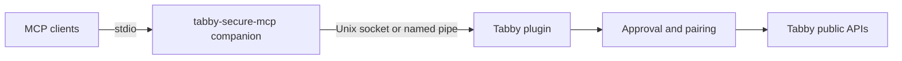

# tabby-secure-mcp

Thin Tabby plugin plus stdio MCP companion that exposes a minimal, approval-gated view of authorized SSH profiles. Untrusted MCP clients can list whitelisted profiles and request opening a visible Tabby SSH tab; they cannot run commands, read terminal output, or access non-whitelisted profiles.

## Architecture



- **`packages/tabby-plugin`** (`tabby-secure-mcp`) — Angular Tabby plugin: settings whitelist, pairing UI, 30s open approvals, lease-aware IPC to the companion, audit log.
- **`packages/companion`** (`@tabby-secure-mcp/companion`) — Node stdio MCP server with three tools; connects outbound to the plugin.
- **`packages/ipc-contract`** — Shared framed IPC schema and limits.

See the [security feasibility review](docs/tabby-secure-mcp-security-feasibility-review.md) for threat model, trust boundaries, and design rationale.

## Quick start

1. Install dependencies and build:

   ```bash
   npm ci
   npm run build
   ```

2. Install into Tabby’s plugins directory (prints plugins path and companion command):

   ```bash
   npm run install:local -- --plugins-dir "$HOME/.config/tabby/plugins"
   ```

   Use `--skip-build` only when `dist/` artifacts are already current.

3. Restart Tabby, whitelist SSH profiles in **Settings → Secure MCP**, then configure MCP clients using the absolute companion path. See [Configure MCP clients](docs/configure-mcp-clients.md).

## Documentation

| Document | Purpose |
| --- | --- |
| [Security feasibility review](docs/tabby-secure-mcp-security-feasibility-review.md) | Threat model and architecture decision record |
| [Configure MCP clients](docs/configure-mcp-clients.md) | Cursor, Claude Code/Desktop, Windsurf stdio setup |
| [Release status](docs/release-status.md) | Platform validation matrix |

## Security scope and limitations

- Protection is **application-layer least privilege** inside the Tabby + OS user trust domain, not kernel-level isolation between Tabby plugins.
- Other Tabby plugins and same-user processes are out of scope for strong isolation.
- MCP tools are **read-only profile listing**, **open in Tabby**, and **read the operation grant**. There is no remote command or output tool.
- The first open of a profile still requires a 30-second approval. Allow stores a permanent open grant until it is revoked in Secure MCP settings or the profile security projection changes.
- Operation tiers authorize **SSH commands**. **Low** authorizes read-only commands, **medium** authorizes read-write commands, and **high** authorizes full-control commands. A higher tier includes every lower command class. The MCP client cannot raise its own tier.
- Pairing is still required. Open approvals that are not already remembered expire after 30 seconds and are single-use.
- Local audit JSONL is hash-chained but cannot detect wholesale log replacement.

## Verification commands

```bash
npm run typecheck
npm test
npm run test:integration
npm run build
npm run pack:check
npm run test:scripts
```

`pack:check` creates real npm tarballs and asserts manifest contents, UMD plugin bundle shape, companion shebang/executable bit, synchronized `0.1.0` versions, and absence of `workspace:` / `file:` dependencies in published tarballs.

## Release notes

The complete flow is manually validated on Linux with Tabby 1.0.238: plugin install,
whitelist persistence, delayed pairing, minimal profile listing, approval-gated SSH
open, and an `env` session check. macOS and Windows remain automated-CI-only until
GUI smoke tests are recorded; see [release status](docs/release-status.md).
