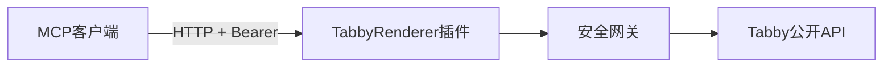
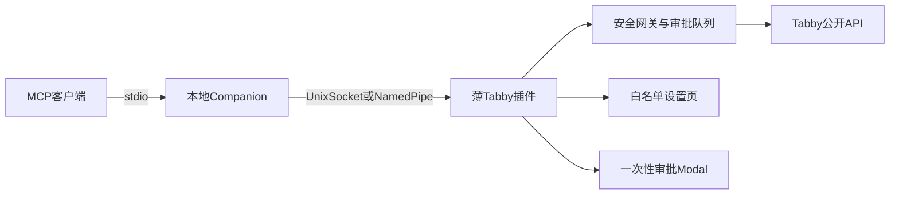
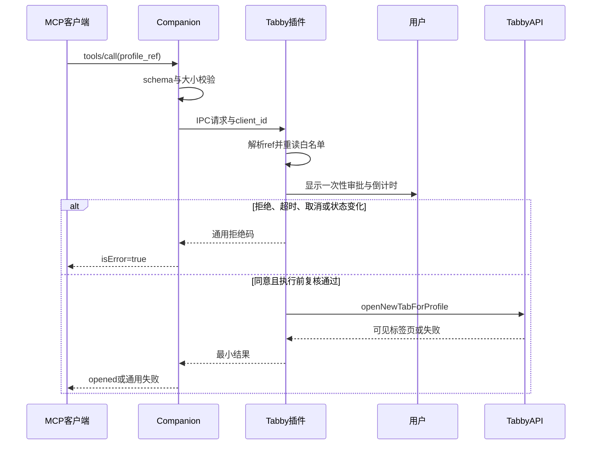

# Tabby Secure MCP 安全可行性评审

> 评审日期：2026-10-15
>
> 评审对象：提案中的安全模型、Tabby API 伪代码、MCP 传输与目标客户端兼容性
>
> 代码基线：Tabby [`467ce8e`](https://github.com/Eugeny/tabby/commit/467ce8ebfa467fb88cf6d154c9a5891e3d3647f0)、MCP TypeScript SDK [`9bc40e9`](https://github.com/modelcontextprotocol/typescript-sdk/commit/9bc40e903fde15534ec06ff4c1347d47000dbe16)、MCP 规范 [`86f6e0c`](https://github.com/modelcontextprotocol/modelcontextprotocol/commit/86f6e0c675afea9a8f233e09b6faf566b126086c)

## 1. 执行摘要

结论是**有条件可行，但原方案不能按现状宣称“底层强隔离”或“彻底封堵越权”**。

可以可靠实现的部分：

- 只向 MCP 投影白名单内 SSH profile 的最小字段；
- 每次高风险操作前在 Tabby 前台执行一次性人工审批，并在超时、窗口关闭或异常时拒绝；
- 使用可见的 Tabby SSH 标签页打开已授权 profile；
- 记录最小化、本地、可校验是否被改写的审计事件；
- 若保留 HTTP，绑定 `127.0.0.1` 并叠加认证、`Host` 与 `Origin` 校验。

必须修正的部分：

- Tabby 插件运行在具有 Node 权限的 Electron renderer 中，没有插件沙箱；其他同权限 Tabby 插件与同用户恶意进程不在本方案可建立的强边界之外。
- 当前没有提案伪代码假设的通用 `SessionsService.createSession()`。SSH 会话应通过 `ProfilesService.openNewTabForProfile()` 打开，再通过公开 terminal API 交互。
- `PlatformService.showMessageBox()` 只能做简单确认，没有 30 秒倒计时能力；强制超时需要自定义 `NgbModal`。
- 当前 MCP 首选 Streamable HTTP，而不是旧式 HTTP+SSE；MCP `2026-07-28` 又移除了早期 Streamable HTTP 的 GET 流和协议级 session，必须针对客户端实际支持版本做兼容测试。
- 每次 Tabby 启动后生成新 Token 并不会自动同步到所有客户端。仅靠“随机 Token”描述缺少安全的分发、存储和轮换闭环。
- Shell 命令黑名单和正则脱敏只能作为辅助检测，不能充当安全边界。
- 同一用户可以改写普通本地文件，因此 `.mcp-audit.log` 不能称为“不可更改”。

建议首版只提供：

1. `list_authorized_ssh_profiles`：返回本次运行生成的、不透明 profile 引用和显示名称；
2. `open_authorized_ssh_profile`：经一次性审批后打开可见 SSH 标签页；
3. 不执行任意命令，不读取或回传终端输出。

后续增加只读工具 `get_ssh_operation_authorization`：查询 Tabby 设置里的永久打开记忆和三级操作策略。它不执行命令，也不能由客户端修改授权。

## 2. 评审边界与攻击者模型

本评审假设：

- Tabby 本体、用户主动安装的本插件以及操作系统内核可信；
- AI 模型、对话内容、远程网页和 MCP 请求均不可信；
- 其他 Tabby 插件、同用户进程和依赖包可能被攻陷，但当前 Tabby 插件模型无法把它们与本插件做进程级强隔离；
- 本方案不对已获得当前用户代码执行权限的恶意软件作出防护承诺。

受保护资产包括：

- 白名单外 profile 的存在性、名称、主机、端口、用户名和凭据；
- 白名单内 profile 的凭据；
- 审批内容与审批决定；
- 终端输出中的业务数据和秘密；
- MCP/IPC 认证材料与审计记录。

安全目标应改写为：

> 在 Tabby 与当前操作系统用户这一既有信任域内，确保不可信 MCP 调用只能看到显式白名单的最小投影，并且每个产生副作用的操作都必须与一次有效人工审批严格绑定。

这是一条**应用层最小权限保证**，不是对 Tabby 插件进程的零信任隔离保证。

## 3. Tabby API 可行性判定

### 3.1 API 矩阵

| 提案能力或调用 | 判定 | 当前可用方式与限制 |
| --- | --- | --- |
| Angular 插件模块 | 可直接采用 | Tabby 插件是由 Node `require()` 加载并加入根 Angular 模块的 npm 包；默认导出应为 `NgModule`。 |
| 在插件内启动本地服务 | 可行但需修正 | renderer 开启 Node integration，因此可用 `node:http`、`node:net`、`node:crypto`；这也意味着服务与其他插件共享高权限信任域。 |
| `ProfilesService.getProfiles()` | 可直接采用 | 当前签名为 `getProfiles(options?)`，返回 `PartialProfile<Profile>[]`。只读取后立即构造最小 DTO，禁止把 profile 对象整体跨边界传递。 |
| `p.type === 'ssh'` | 可采用但不能单独授权 | 类型过滤只确认 profile provider；最终仍必须同时命中本地白名单，并在执行前重新读取 profile。 |
| `ConfigService.store` + `save()` | 需要修正 | 直接更新插件命名空间可行，但应通过 `ConfigProvider` 注册默认值，并 `await config.save()`；白名单不得包含凭据副本。 |
| 独立设置页 | 可直接采用 | 继承 `SettingsTabProvider`，在 `getComponentType()` 返回设置组件，并以 `multi: true` 注册。 |
| `PlatformService.showMessageBox()` | 仅适合简单确认 | API 存在，但不提供倒计时和丰富内容布局。30 秒 Default Deny 应使用 `NgbModal.open()` 的自定义组件实现。 |
| `SessionsService.createSession()` | 不可采用 | 当前没有此通用公开 API。应调用 `ProfilesService.openNewTabForProfile(profile)`。 |
| 向 SSH 标签页发送输入 | 后续阶段可用 | 等待 terminal frontend 就绪后使用 `BaseTerminalTabComponent.sendInput()`；不要直接写底层 session。 |
| 捕获 SSH 输出 | 后续阶段可用但高风险 | `output$`/`binaryOutput$` 只提供订阅后的输出，没有历史重放。应使用 `TerminalDecorator` 建立显式 registry，并严格限制订阅生命周期。 |
| 从 `AppService.activeTab` 取得终端 | 不可依赖 | 活动标签可能是 split 容器；应使用 focused tab 或 decorator registry。 |
| 每个 Tabby 应用只启动一台服务 | 需要额外设计 | 每个窗口都会加载插件并拥有自己的 Angular service。`BootstrapData.isMainWindow` 可用于限制主窗口启动，但主窗口关闭后的接管没有稳健公开 API。 |

### 3.2 官方源码证据

- 插件发现、加载及默认 Angular 模块导出：
  [plugin loader](https://github.com/Eugeny/tabby/blob/467ce8ebfa467fb88cf6d154c9a5891e3d3647f0/app/src/plugins.ts#L102-L190)。
- renderer 启用 `nodeIntegration` 且关闭 `contextIsolation`：
  [window configuration](https://github.com/Eugeny/tabby/blob/467ce8ebfa467fb88cf6d154c9a5891e3d3647f0/app/lib/window.ts#L59-L76)。
- `ProfilesService.getProfiles()` 与 `openNewTabForProfile()`：
  [profiles service](https://github.com/Eugeny/tabby/blob/467ce8ebfa467fb88cf6d154c9a5891e3d3647f0/tabby-core/src/services/profiles.service.ts#L86-L105),
  [profile opening](https://github.com/Eugeny/tabby/blob/467ce8ebfa467fb88cf6d154c9a5891e3d3647f0/tabby-core/src/services/profiles.service.ts#L175-L200)。
- `ConfigProvider` 与 `ConfigService.save()`：
  [configuration defaults](https://github.com/Eugeny/tabby/blob/467ce8ebfa467fb88cf6d154c9a5891e3d3647f0/tabby-core/src/api/configProvider.ts#L1-L36),
  [configuration persistence](https://github.com/Eugeny/tabby/blob/467ce8ebfa467fb88cf6d154c9a5891e3d3647f0/tabby-core/src/services/config.service.ts#L228-L270)。
- 设置页扩展点：
  [SettingsTabProvider](https://github.com/Eugeny/tabby/blob/467ce8ebfa467fb88cf6d154c9a5891e3d3647f0/tabby-settings/src/api.ts#L1-L14)。
- 简单消息框：
  [PlatformService.showMessageBox](https://github.com/Eugeny/tabby/blob/467ce8ebfa467fb88cf6d154c9a5891e3d3647f0/tabby-core/src/api/platform.ts#L263-L271)。
- 终端输入输出与 decorator：
  [terminal streams](https://github.com/Eugeny/tabby/blob/467ce8ebfa467fb88cf6d154c9a5891e3d3647f0/tabby-terminal/src/api/baseTerminalTab.component.ts#L166-L192),
  [sendInput](https://github.com/Eugeny/tabby/blob/467ce8ebfa467fb88cf6d154c9a5891e3d3647f0/tabby-terminal/src/api/baseTerminalTab.component.ts#L503-L514),
  [TerminalDecorator](https://github.com/Eugeny/tabby/blob/467ce8ebfa467fb88cf6d154c9a5891e3d3647f0/tabby-terminal/src/api/decorator.ts#L4-L37)。

## 4. MCP 与客户端兼容性判定

### 4.1 传输与 SDK

原伪代码使用的 `@modelcontextprotocol/sdk/server/index.js` 和
`setRequestHandler()` 属于旧版 SDK 形态。当前 TypeScript SDK 2.x 已拆分为
`@modelcontextprotocol/server`、`@modelcontextprotocol/node`、
`@modelcontextprotocol/express` 等包；新实现应使用 `McpServer`、
`registerTool()` 和对应 transport/handler，不应复制旧版示例。

若使用 HTTP：

- 使用单一 `/mcp` POST endpoint；
- 自定义 middleware 对 HTTP authority 做规范化后精确校验，只允许实际配置的
  `127.0.0.1:<port>`；拒绝重复 `Host`、错误端口、`localhost` 别名和 IPv6；
- `Origin` 缺失时可供非浏览器客户端通过；只要存在，就必须与明确白名单匹配，否则返回 403；
- 不返回宽松 CORS header；
- 所有请求都先认证，再解析有大小上限的 JSON body；
- 不把 loopback 绑定当成认证；
- 根据目标客户端协商版本，不能假设所有客户端已支持 MCP `2026-07-28`。

当前 SDK 的 `validateHostHeader()` helper 只按 hostname 判断、刻意忽略端口，不能单独满足
上述精确 authority 策略；可以复用其 hostname 解析，但必须叠加自定义端口与重复 header
校验。

当前规范明确要求 Streamable HTTP 校验 `Origin`，本地服务应只绑定
`127.0.0.1` 并实施认证。MCP `2026-07-28` 已移除 GET stream 和协议级
session；旧 HTTP+SSE 自 `2025-03-26` 起已弃用。

官方证据：

- [MCP 2026-07-28 Streamable HTTP](https://modelcontextprotocol.io/specification/2026-07-28/basic/transports/streamable-http)
- [本地 MCP 服务安全指南](https://modelcontextprotocol.io/docs/2026-07-28/tutorials/security/local-server-security)
- [SDK 2.x server package](https://github.com/modelcontextprotocol/typescript-sdk/blob/9bc40e903fde15534ec06ff4c1347d47000dbe16/packages/server/package.json)
- [SDK Host 校验](https://github.com/modelcontextprotocol/typescript-sdk/blob/9bc40e903fde15534ec06ff4c1347d47000dbe16/packages/server/src/server/middleware/hostHeaderValidation.ts)
- [SDK Origin 校验](https://github.com/modelcontextprotocol/typescript-sdk/blob/9bc40e903fde15534ec06ff4c1347d47000dbe16/packages/server/src/server/middleware/originValidation.ts)
- [SDK Bearer auth 示例](https://github.com/modelcontextprotocol/typescript-sdk/tree/9bc40e903fde15534ec06ff4c1347d47000dbe16/examples/bearer-auth)

### 4.2 Token 方案判定

`UUIDv4` 的随机性通常足以抵抗在线猜测，但 Token 设计不应只关注随机强度。
建议 HTTP fallback 使用 `crypto.randomBytes(32)` 产生 256-bit Token，并满足：

- 服务端只在内存中保存，客户端副本只能进入操作系统 secret store；
- 日志、错误消息和设置导出中永不出现 Token；
- 使用恒定时间比较；
- 限制失败速率；
- 明确启动、轮换、客户端获取、撤销和 Tabby 退出后的销毁流程。

“插件每次启动自动生成 Token”在客户端侧并不普遍可用：

| 客户端 | 文档能力（仍需固定版本黑盒验证） | 自动跟随轮换 Token |
| --- | --- | --- |
| Cursor | 文档支持本地/远程 Streamable HTTP、自定义 header 与环境变量插值 | 静态环境变量不会获得子进程后来生成的新值。需要 Cursor 扩展动态重新注册 MCP server，或人工更新并重启。 |
| Claude Code | 支持 `type: "http"`、自定义 header、环境变量和 `headersHelper` | `headersHelper` 可在连接、重连及 401/403 后重新读取当前 Token，是目标客户端中最完整的动态方案。 |
| Claude Desktop 本地扩展 | 当前 MCPB 本地扩展以 stdio 可执行程序为主 | 没有直接读取 Tabby 动态 HTTP Token 的通用机制；需要 stdio companion/proxy。 |
| Windsurf | 文档支持 HTTP URL、header、`${env:...}` 与 `${file:...}` | 文档未保证每次重连都会重新读取 Token 文件，必须做版本化实测。 |

客户端来源：

- [Cursor MCP](https://cursor.com/docs/mcp)
- [Cursor Extension API](https://cursor.com/docs/extension-api)
- [Claude Code MCP](https://code.claude.com/docs/en/mcp)
- [Claude Desktop 本地 MCP](https://support.claude.com/en/articles/10949351-getting-started-with-local-mcp-servers-on-claude-desktop)
- [MCPB manifest](https://github.com/modelcontextprotocol/mcpb/blob/main/MANIFEST.md)
- [Windsurf MCP](https://docs.windsurf.com/windsurf/cascade/mcp)

这些是文档层候选能力，不是本项目已取得的兼容测试结果。因此，若目标是同时支持
Cursor、Claude Desktop/Code 与 Windsurf，**stdio companion 是比 renderer 内 HTTP +
动态 Token 更稳妥的候选共同基线**，最终支持范围必须由第 8.8 节固定版本测试决定。

HTTP fallback 在每个启用客户端都有明确、经过测试的 secret-store 分发路径前不得发布：

- Cursor 只能通过受信任扩展从 secret store 获取 Token 并动态注册；
- Claude Code 只能通过从 secret store 读取的 `headersHelper` 获取；
- Claude Desktop 不使用该 HTTP fallback；
- Windsurf 在证实可安全刷新 secret-store Token 前保持禁用。

不得用通用明文临时文件作为跨客户端分发捷径。

## 5. 修正版安全模型

### 5.1 原四条底线的修订

| 原规则 | 评审结果 | 修订后的可验证规则 |
| --- | --- | --- |
| 白名单外资产对 AI 完全不可见 | 方向正确，表述过强 | MCP 数据面不得返回白名单外 profile 的任何字段，也不得通过不同错误或计数暴露其存在性；响应时序只做尽量归一化，不作无旁路承诺。这不代表同权限 Tabby 插件无法读取配置。 |
| 启动时生成 UUIDv4 Token | 仅适用于 HTTP，且缺少分发闭环 | 首选 stdio，取消 HTTP Token。HTTP fallback 使用 256-bit Token、严格生命周期和按客户端验证过的分发方式。 |
| 每次连接或命令均弹窗，30 秒默认拒绝 | 正确但简单消息框不足 | 使用自定义审批 modal；批准必须绑定请求摘要，超时、窗口关闭、Tabby 失焦、请求取消和异常全部拒绝。 |
| 只监听 `127.0.0.1` | 必要但不充分 | HTTP fallback 同时要求精确 bind、`Host`/`Origin` 校验、认证、body 上限、无 CORS、速率限制和安全退出。 |

### 5.2 Profile 最小投影与能力引用

插件可以在内部读取全部 profile 以完成设置页展示，但跨 MCP/IPC 边界时只能构造新的
DTO，禁止扩展运算整个 profile：

```ts
interface AuthorizedProfileView {
  profile_ref: string
  display_name: string
}
```

`profile_ref` 不应直接等于 Tabby profile ID。每次插件启动时为当前白名单 profile
生成随机、不透明引用，维护仅存在于内存中的双向映射：

```text
profile_ref -> tabby_profile_id
```

这样能避免 MCP 调用者猜测真实 ID，也能在重启时自然撤销旧引用。列表默认不返回
host、port、username、group、SSH jump host 或配置来源；如业务确实需要显示目标，
由设置页逐项开启字段，并在 UI 中明确说明泄露范围。

所有未知、过期、非白名单和已删除引用都返回同一个通用错误：
`target unavailable`。不得用错误文案或响应状态区分“存在但未授权”和“不存在”。

### 5.3 审批协议

审批不是一个布尔弹窗，而是一段有状态、Default Deny 的协议：

1. Gatekeeper 接收已通过 schema 校验的结构化操作。
2. 重新读取当前 profile 与白名单，不使用列表阶段的旧对象。
3. 构造不含明文秘密的 `ProfileSecuritySnapshot`：profile ID、provider/type、host、port、
   username、jump/proxy 配置、认证方式、凭据引用或版本指纹、host-key 策略与影响连接目标的
   其他选项。
4. 生成 128-bit `request_id`，并对以下规范化内容计算摘要：
   `tool + profile_ref + profile_security_snapshot + operation + parameters + expires_at`。
5. 审批队列一次只显示一个请求；其他请求等待或被限流，防止多个弹窗造成授权混淆。
6. Modal 显示工具、profile 显示名、完整操作和参数、请求来源、剩余时间。所有不可见控制字符、
   ANSI escape、双向文本控制字符都必须转义或标注。
7. 首次打开某个 profile 时，用户选择“允许”或“拒绝”。允许会把这次打开记为永久授权，直到用户在 Secure MCP 设置里撤销，或 profile 的安全投影发生变化。不提供五分钟临时记忆。MCP 客户端不能自行提升授权。
8. 30 秒到期、关闭 modal、Tabby 退出、插件销毁、客户端取消或审批组件异常均产生拒绝。
9. 批准结果只对相同 `request_id` 和摘要有效，且只能消费一次。
10. 执行前重新构造 `ProfileSecuritySnapshot` 并比较审批摘要；任何安全相关字段变化都拒绝并
    要求重新审批。

首版的 `open_authorized_ssh_profile` 仍需审批。仅列出已授权 profile 是只读操作，
可不弹窗，但必须接受速率限制并写入审计事件。

### 5.4 命令执行策略

原方案的 `connect_and_run_command(profile_id, command)` 不应进入首版，原因包括：

- Shell 等价表达方式太多，`rm -rf`、`dd`、重定向等字符串黑名单易被变量、
  编码、脚本解释器、别名、换行、子 Shell 和远程下载绕过；
- 人工看到的字符串不一定等于远端 Shell 最终执行的语义；
- 终端可能处于编辑器、交互程序、密码提示或另一条命令中，盲目 `sendInput()` 会造成混淆；
- 审批后 profile、当前目录、远端用户或 shell 状态可能已改变。

当前阶段只持久化三级授权策略，不执行远端命令：低级只读、中级读写、高级完全控制。较高一级覆盖其自身和全部更低级别。高级完全控制仍不表示原始 shell、隐式 sudo、解释器、端口转发或文件传输。策略由 `evaluateStructuredOperation` 判定；MCP 只能通过 `get_ssh_operation_authorization` 读取当前级别和静态策略。profile 安全投影变化后，打开记忆和操作级别一并失效，直到用户重新允许打开或在设置中重新保存。

若后续确有自动化需求，只增加结构化工具：

```ts
interface ApprovedOperationRequest {
  profile_ref: string
  operation_id: string
  parameters: Record<string, string | number | boolean>
}
```

`operation_id` 必须对应用户在 Tabby 设置中本地创建或启用的固定模板。模板声明参数
schema、渲染方式、允许的远端用户、超时、最大输出和是否允许网络。参数使用目标命令
支持的参数数组或严格编码器，不通过字符串拼接生成 Shell。`sudo`、交互式程序、端口转发、
文件上传下载和任意解释器执行分别作为独立能力审批，不能由通用命令模板隐式获得。

命令危险模式检测可以改变警告等级或直接拒绝明显事故，但测试不能把它当成阻止越权的
证明。

### 5.5 输出处理

首版不读取终端输出。后续阶段即使执行结构化操作，也采用以下顺序：

1. 为操作创建专用、可见的终端上下文，不从用户已有交互会话抓取历史；
2. 仅订阅该操作开始后的输出，并在完成、取消、超时或 tab 关闭时立即退订；
3. 默认上限建议为 30 秒和 64 KiB UTF-8 文本，先到即停止并返回 `truncated: true`；
4. 去除 ANSI 控制序列并标记无效 UTF-8；二进制输出不回传；
5. 私钥块、常见 access token 和显式密码字段的脱敏作为纵深防御；
6. 对不能可靠识别的秘密不作“已安全脱敏”承诺；
7. 输出不进入审批日志，除非用户另行启用经过说明的诊断模式。

正则脱敏永远不完备：任意业务密钥格式、分片输出、编码内容和压缩数据都可能逃逸。
真正的控制是**不采集、限制采集范围和限制回传量**。

### 5.6 审计

审计日志采用 JSON Lines，每条事件只记录：

- 单调递增序号、UTC 时间和随机 event ID；
- 客户端类型与匿名化实例 ID；
- 工具名、`profile_ref`、`operation_id`；
- 请求参数的摘要，而不是原始命令或终端输出；
- `approved`、`denied`、`expired`、`cancelled`、`failed` 或 `completed`；
- 失败阶段和稳定错误码；
- 前一条记录摘要与本条记录摘要。

文件以当前用户专属权限创建（Unix `0600`；Windows 使用当前用户 ACL），追加时使用
append 模式。哈希链可以检测链中记录的修改、插入、删除、重排及跨轮换文件的不连续；
Token、SSH 凭据、完整 host、原始输出和弹窗自由文本不得写入。

没有可信外部 checkpoint 时，本地哈希链**不能**检测尾部记录删除、整份日志替换或攻击者
重新计算全链，也不能提供不可变性。拥有相同用户权限的进程可以完成这些操作。需要检测
这些场景时，必须把链尾摘要定期提交到操作系统审计设施或独立、只追加的远程日志系统；
该扩展不属于首版，首版只能宣称“链内一致性可校验”。

### 5.7 残余风险

即使完整实现上述控制，仍然存在：

- 被攻陷的 Tabby 本体或其他高权限插件可绕过本插件；
- 当前用户权限下的恶意进程可读取 UI、模拟输入或篡改本地状态；
- 用户可能批准看似合理但实际有害的操作；
- profile 本身可能指向被替换的主机或经受 DNS/跳板机变化；
- 远端输出可能包含未知格式的秘密或提示注入；
- 依赖升级可能改变 Tabby 或 MCP API 行为。

因此，生产资产还应由 SSH 侧的独立控制保护：专用低权限账号、短期证书、命令限制、
网络 ACL、堡垒机审计和服务器端最小权限。本插件不能替代这些边界。

## 6. 架构选项

### 6.1 选项 A：renderer 内嵌 Streamable HTTP



优点：

- 单个 npm 插件即可交付；
- 设置页、审批 UI 和会话 API 在同一个 Angular DI 上下文中；
- 对支持 HTTP header 的客户端配置直观。

缺点：

- 每个 Tabby 窗口都会加载插件，需要选主、端口竞争和主窗口退出后的接管机制；
- renderer 生命周期与 MCP 服务生命周期耦合；
- 暴露本地 TCP 端口，必须长期维护 Token 分发、`Host`/`Origin`、请求解析和兼容层；
- Token 轮换在目标客户端间行为不一致；
- 服务与其他 Tabby 插件共享 Node 权限和 renderer 信任域；
- 当前客户端未公开统一的 MCP 协议版本矩阵。

适用范围：内部 PoC，或只提供“列出授权引用/打开可见标签页”的低能力部署。即便如此，
也必须实施第 5 节全部适用控制，不能因为监听 loopback 而简化鉴权。

### 6.2 选项 B：薄 Tabby 插件 + stdio companion（推荐）



职责划分：

| 单元 | 唯一职责 | 明确不做 |
| --- | --- | --- |
| Companion | 实现 MCP stdio、schema 校验、请求取消和到插件的受限 RPC | 不读取 Tabby 配置，不持有 SSH 凭据，不执行 SSH，不启动 HTTP 服务 |
| Tabby plugin | 读取并最小投影 profile、执行白名单复核、显示审批、调用公开 Tabby API | 不接受任意对象反序列化，不把完整 profile/Config 跨 IPC 发送 |
| Gatekeeper | 串行审批、摘要绑定、一次性消费、Default Deny 和审计 | 不依赖 MCP 客户端自行审批。永久打开记忆只保存在 Tabby 配置，profile 投影变化后失效 |
| Settings | 管理显式白名单、永久打开记忆和只读 / 读写 / 完全控制三级策略 | 不保存凭据副本。MCP 客户端不能修改级别 |

IPC 基线：

- Linux/macOS 使用位于当前用户 runtime 目录的 Unix domain socket，父目录权限 `0700`，
  socket/descriptor 权限 `0600`；
- Windows 使用带当前用户 SID ACL 的 Named Pipe；
- Companion 默认只允许一个活跃客户端实例，并使用进程锁防止多个 AI 客户端争抢审批；
- Companion 创建 256-bit pairing nonce，descriptor 仅保存 endpoint、PID、到期时间和
  nonce，且使用用户专属权限；
- Tabby plugin 主动连接 Companion，而不是在 renderer 中监听 TCP；
- 建连时双方执行 challenge-response，并在 Tabby 中显示客户端名称，首次配对需人工确认；
- 每个窗口生成独立 `window_instance_id` 并向 Companion 注册
  `BootstrapData.isMainWindow`；Companion 只向一个实例发放带递增 epoch 的排他 lease，
  优先选择 main window，其他窗口保持 standby 且不能接收请求；
- lease holder 断开时，Companion 先取消全部 pending/approved 请求并进入 unpaired；
  存活窗口只能通过一次新的用户配对取得新 epoch，不允许无提示接管旧审批；
- IPC 消息使用有长度上限的 JSON schema；拒绝未知字段、原型污染键、超大消息和乱序响应；
- 任一端退出、重启或 nonce 到期都会撤销映射与待处理审批。

该选项的主要收益是：

- 四类目标客户端的当前文档都提供本地 stdio 配置路径，但仍需第 8.8 节固定版本实测；
- 不开放浏览器可访问的 localhost HTTP 端口；
- 不需要向不同客户端分发动态 Bearer Token；
- MCP 生命周期归客户端管理，Tabby 多窗口不再竞争 HTTP 端口，并由 Companion lease
  明确唯一 Gatekeeper；
- Companion 与插件接口可以保持极小并独立模糊测试。

该选项**不自动提供 OS 级沙箱**。Companion 仍是当前用户进程；如果它或其依赖被攻陷，
理论上可以读取当前用户可读文件。降低该风险需要最小依赖、锁定依赖树、可复现构建、
签名发布、SBOM、及时升级，以及条件允许时使用独立低权限用户或 OS sandbox。IPC ACL
只防其他用户和意外访问，不防已经取得当前用户权限的恶意软件。

### 6.3 不推荐选项：独立 SSH MCP

让 Companion 自己解析 Tabby 配置并直接建立 SSH 连接看似能绕过 renderer 生命周期，
但会复制或读取 SSH 凭据、绕过 Tabby 前台审批与可见会话，并产生第二套 SSH
实现和 host-key 策略。它不符合本项目“以 Tabby 为用户控制面”的目标，不进入后续方案。

### 6.4 决策

| 维度 | 内嵌 HTTP | stdio companion |
| --- | --- | --- |
| MCP 客户端共同支持 | 需要逐客户端处理 header/版本 | 候选共同基线，仍需固定版本实测 |
| 浏览器/localhost 攻击面 | 存在，需持续加固 | 无 TCP 监听 |
| Tabby 多窗口 | 需要选主和故障接管 | Companion 排他 lease；故障后必须重新配对 |
| 动态 Token 分发 | 复杂且客户端不一致 | 客户端侧不需要 Bearer Token |
| 交付复杂度 | 较低 | 较高，需要 companion 与 IPC |
| OS 级隔离 | 无 | 默认仍无，需要额外 sandbox |
| 推荐用途 | PoC 或兼容 fallback | 正式 MVP |

正式 MVP 选择选项 B。选项 A 只保留为显式启用的兼容 fallback，并且不得与 stdio
模式同时默认开启。首版 companion 和插件都不引入任意命令执行。

## 7. 推荐数据流

以 `open_authorized_ssh_profile` 为例：



`list_authorized_ssh_profiles` 也必须由插件实时生成。Companion 不缓存 profile 列表，
只可在单次请求期间转发结果；白名单修改后，旧 `profile_ref` 立即失效。

## 8. 实现与发布准入条件

以下条件使用“必须”表示 release blocker。首版只有在全部适用项都有自动化或可重复的
集成测试证据时，才能标记为 Security-First MVP。

### 8.1 规范化安全限值

除非后续 threat-model review 明确修改，首版采用以下可测试限值：

| 控制项 | 限值或行为 |
| --- | --- |
| IPC 单 frame | 最大 64 KiB；超限立即断开 |
| IPC 单连接未解析缓冲 | 最大 128 KiB |
| JSON | 最大深度 16；单字符串最大 8 KiB；拒绝未知字段 |
| IPC handshake | 5 秒内完成，否则关闭并撤销 nonce |
| MCP 并发请求 | 每客户端最多 4 个；其中最多 1 个显示审批，超限返回稳定 `busy` 错误 |
| 请求速率 | 每客户端每分钟 20 次，允许瞬时 burst 5；超限返回 `rate_limited` |
| 审批 | 30 秒；失焦、取消、断开或异常立即拒绝 |
| HTTP header/body | header 合计最大 16 KiB；body 最大 64 KiB |
| HTTP 慢请求 | header 与 body 各 5 秒 deadline；超时关闭 |
| HTTP 并发连接 | 全局最多 16 个 |
| HTTP 认证失败 | 全局每分钟最多 5 次；超限 60 秒内返回 429 |
| 后续阶段输出 | 30 秒或 64 KiB，先到即停止 |
| 审计文件 | 单文件最大 10 MiB 后轮换，并保留链连续性 |

这些限值控制资源消耗，不形成 timing side-channel 不存在的证明。未知、过期、未授权和
删除引用必须走同一验证阶段、错误码与安全文案；不规定不可现实验证的恒定响应时间。

### 8.2 开始实现前

- [ ] 接受选项 B 作为正式 MVP 架构；HTTP 只作为后续显式 fallback。
- [ ] 冻结首版工具集为 `list_authorized_ssh_profiles` 与
      `open_authorized_ssh_profile`，工具列表中不存在通用命令、终端读取、文件传输或端口转发。
- [ ] 明确支持的最低 Tabby 版本和各目标 MCP 客户端版本，CI 使用相同版本测试。
- [ ] 固定 Node、Angular、Tabby peer package 与 MCP SDK 版本，提交 lockfile。
- [ ] 为 companion、IPC、Gatekeeper、设置页和审计分别定义独立接口；完整 Tabby profile
      类型不得出现在 IPC public contract 中。
- [ ] 建立安全变更规则：新增 tool、扩大 profile 字段、延长授权、增加输出或启用 HTTP
      均需单独 threat-model review。

### 8.3 非授权资产零泄露

测试夹具至少包含：

- 一个已授权 SSH profile；
- 两个未授权 SSH profile，其中名称、host、username 和 ID 均使用唯一 canary；
- 一个非 SSH profile；
- 一个删除后仍被旧请求引用的 profile。

必须验证：

1. `list_authorized_ssh_profiles` 只返回 `profile_ref` 与 `display_name`；
2. 响应、错误、IPC trace、审计日志和 companion stderr 中均找不到未授权 canary；
3. 返回的 `profile_ref` 不包含或等于 Tabby profile ID，重启后旧引用失效；
4. 未知、过期、未授权和删除引用的 MCP 错误码与安全文案相同；
5. 白名单从 A 改为 B 后，不重启即可使 A 的引用失效；
6. 设置页可以显示本地 profile，但 UI 数据不会进入 MCP response 或 companion cache；
7. fuzz 输入中的 `__proto__`、`constructor`、超长字符串、额外字段和错误类型全部被 schema
   层拒绝，且不会触发 profile 查询。

### 8.4 审批闭环

必须使用可控制的 fake clock 和真实 modal 集成测试验证：

- 没有用户动作时恰好在 30 秒边界进入 `expired`，不调用 Tabby API；
- 点击关闭、Esc、窗口失焦、Tabby 退出、companion 断开和 MCP cancellation 都拒绝；
- 默认焦点不在“允许”，键盘 Enter 不能意外批准；
- 同一审批只能消费一次，重放 `request_id` 或摘要得到拒绝；
- 在 modal 展示后修改白名单、provider/type、profile ID、host、port、username、
  jump/proxy、认证方式、凭据引用、host-key 策略或操作参数会使批准失效；
- 两个并发请求不会共享弹窗或决定；只有当前显示请求能被批准；
- ANSI、换行、制表符、零宽字符和双向文本控制字符在 modal 中被安全转义；
- 审批 UI 始终显示客户端身份、工具名、目标显示名、完整结构化操作和倒计时；
- 审批组件抛异常时走拒绝路径，并留下不含秘密的稳定审计码。

### 8.5 IPC 与生命周期

必须在 Linux、macOS、Windows 的目标 CI/手工矩阵中验证：

- Unix runtime 目录为 `0700`、descriptor/socket 为 `0600`；Windows pipe ACL 只允许当前用户；
- 其他 OS 用户无法连接；错误 nonce、过期 nonce、旧 PID descriptor 和重放 challenge 被拒绝；
- 64 KiB 单 frame 与 128 KiB 累计缓冲限值生效；部分 frame、粘包、乱序响应和未知消息
  类型安全失败；
- companion/plugin 任一端重启都会取消全部待处理请求、关闭审批并使旧引用失效；
- 同时启动第二个 companion 时失败关闭，不出现两个客户端共用审批；
- 打开第二个 Tabby 窗口时只有 lease holder 能接收请求，standby 使用请求被拒绝；
- 关闭 lease holder 时，所有 pending/approved 请求先拒绝并递增 epoch；存活窗口必须经过
  新的用户配对才能取得 lease，不静默转移已批准请求；
- Tabby 完全退出后，不留下 socket、descriptor、Token 或可复用审批状态。

### 8.6 HTTP fallback（启用时才适用）

HTTP 模式默认关闭。任何发布版本若提供该选项，必须额外验证：

- 进程只 bind `127.0.0.1`，不 bind `0.0.0.0`、LAN 地址或隐式双栈地址；
- 缺失或错误 Token 在读取 JSON body 前返回 401；
- 错误端口、`localhost` 别名、IPv6、重复 `Host`、任意网页 `Origin`、`Origin: null` 和
  DNS rebinding 场景返回 403；测试不得只调用 SDK 的 port-agnostic hostname helper；
- 不发送 `Access-Control-Allow-Origin: *`，预检请求不能获得调用权限；
- 超过 16 KiB header、超过 64 KiB body、超过 5 秒的 header/body、畸形 JSON 和超过
  16 个并发连接按第 8.1 节失败关闭；
- Token 至少 256 bit、从不写日志，并在 Tabby/服务退出时撤销；
- 每分钟第 6 次认证失败开始返回 429，并维持 60 秒；
- Cursor 必须通过受信任扩展、Claude Code 必须通过 `headersHelper` 从 secret store
  获得 Token；Windsurf 在没有等价且验证过的流程前不启用 HTTP；
- 任何配置和 runtime 目录中都不存在明文 Token 文件；
- 协议兼容套件覆盖目标客户端使用的 MCP 版本，旧 HTTP+SSE endpoint 不默认启用。

### 8.7 审计与数据保护

必须验证：

- allow、deny、expire、cancel、fail、complete 均产生一条稳定 schema 的事件；
- SSH 凭据、Token、完整 host、未授权 canary、终端输出和自由文本不出现在日志；
- 修改、插入、重排和非尾部删除会被验证器发现；
- 日志轮换保留跨文件链头/链尾，并且失败时 Default Deny，而不是继续无审计执行；
- 测试与文档明确证明：没有外部 checkpoint 时，尾部删除、整份替换和全链重算不会被本地
  哈希链可靠发现；
- Unix 权限和 Windows ACL 符合当前用户专属要求；
- 日志写满、磁盘只读、时钟回拨和进程崩溃不会产生“已批准但无决定记录”的操作；
- 首版没有 terminal output 订阅。后续引入输出时，另行验证 30 秒、64 KiB、退订、
  截断标志、ANSI 清理和脱敏 canary。

### 8.8 客户端兼容矩阵

下表是发布 gate，不代表当前已经通过。每个受支持客户端必须记录产品版本、OS 与 MCP
配置，并在该固定版本上完成以下同一套黑盒场景：

| 场景 | Cursor | Claude Code | Claude Desktop | Windsurf |
| --- | --- | --- | --- | --- |
| 启动 stdio companion | 必须 | 必须 | 必须 | 必须 |
| 列出一个授权 profile | 必须 | 必须 | 必须 | 必须 |
| 打开 profile 并显示审批 | 必须 | 必须 | 必须 | 必须 |
| 用户拒绝/超时得到安全错误 | 必须 | 必须 | 必须 | 必须 |
| MCP 取消能关闭审批 | 必须 | 必须 | 必须 | 必须 |
| companion 重启后恢复配对 | 必须 | 必须 | 必须 | 必须 |
| 工具 schema 不含命令/输出能力 | 必须 | 必须 | 必须 | 必须 |

如果某客户端不能满足取消或重连语义，应在该版本上标记为不支持，而不是通过放宽审批
或复用旧授权来兼容。

### 8.9 供应链与发布

- [ ] companion 与插件来自同一仓库和版本，发布物具有校验和与签名。
- [ ] 生成 SBOM；CI 对直接和传递依赖执行漏洞扫描，Critical/High 未处置项阻断发布。
- [ ] 锁定完整依赖树，不在运行时执行 `npx latest`、下载脚本或动态安装。
- [ ] 构建产物可从 tag 和 lockfile 重现，release workflow 使用最小权限。
- [ ] 对 `npm pack` 后的内容做 allowlist 检查，不发布源码凭据、测试 fixture secret 或本地路径。
- [ ] 记录 Tabby 与 MCP SDK 升级时必须重跑的 API、IPC、客户端和安全测试矩阵。

## 9. 最终判定

| 问题 | 判定 |
| --- | --- |
| 能否开发 Tabby Secure MCP？ | 能。Tabby 当前公开 API 足以实现白名单、设置页、审批和打开可见 SSH 会话。 |
| 原伪代码能否直接实现？ | 不能。Session API、倒计时 modal、SDK imports、transport 与多窗口生命周期均需重写。 |
| 能否称为“底层强隔离”？ | 不能。Tabby 插件共享高权限 renderer，同用户 companion 默认也不是 sandbox。 |
| loopback + Token 是否足够？ | 不够。还需 `Host`/`Origin`、分发轮换、解析上限、速率限制和客户端实测。 |
| 任意命令 + 人工确认是否适合首版？ | 不适合。首版只列授权引用并打开可见会话。 |
| 推荐架构是什么？ | 薄 Tabby plugin + stdio companion + 用户专属 IPC + 一次性审批。 |
| 何时可以进入实现？ | 接受第 6.4 节决策与第 8.2 节范围后，可单独制定 MVP 实施计划。 |

该方案在收紧能力后可以成为可靠的**最小权限控制面**。它不能代替 SSH 服务端权限、
堡垒机或 OS sandbox，也不应以“彻底封堵”描述其保证范围。
